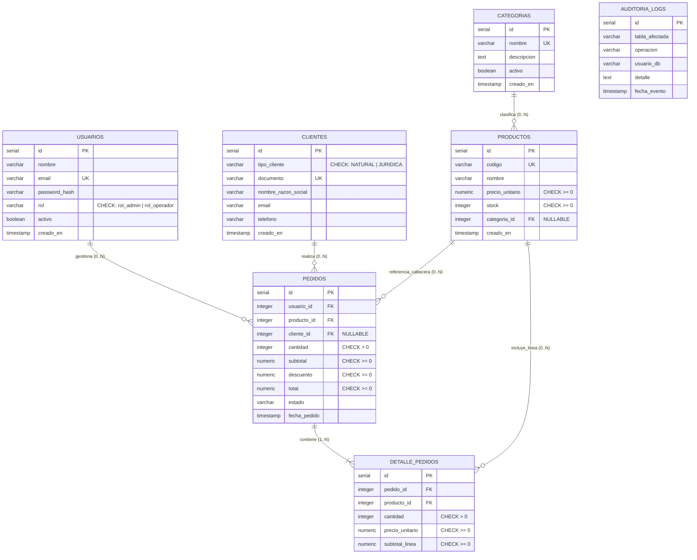
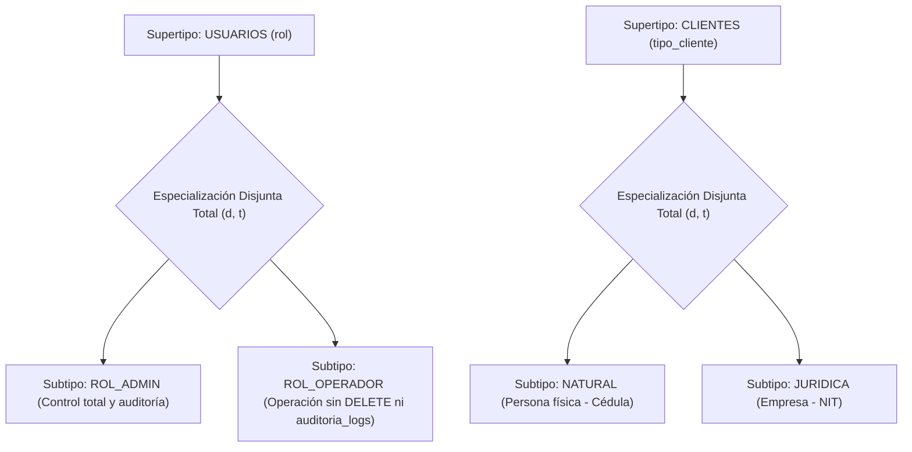

# Modelo Entidad-Relación Extendido (MERE) — TechCore Store

**Dominio:** Sistema de Gestión Comercial, Inventario y Ventas de Tecnología  
**Motor:** PostgreSQL (Supabase)  
**Script DDL/DML/PLpgSQL/DCL:** [database/init.sql](../database/init.sql)

---

## 1. Diagrama Entidad-Relación (`erDiagram`)

> **Nota sobre auditoría automática:** `AUDITORIA_LOGS` no tiene llave foránea hacia las entidades operativas para preservar la trazabilidad histórica incluso cuando un registro de negocio es eliminado (`DELETE`) por `rol_admin`. Su alimentación ocurre mediante triggers `AFTER INSERT OR UPDATE OR DELETE` sobre `usuarios`, `productos`, `clientes`, `pedidos` y `detalle_pedidos`.

---

## 2. Especializaciones Disjuntas del MERE

El modelo incorpora dos jerarquías de especialización **disjunta y total** implementadas mediante atributo discriminador con restricción `CHECK` y control de privilegios en base de datos:

1. **Especialización de `USUARIOS` (`rol IN ('rol_admin', 'rol_operador')`):**
   - **Disjunta y total:** todo usuario registrado pertenece obligatoriamente a un único rol.
   - Se mapea directamente al mecanismo de seguridad de PostgreSQL mediante `SET ROLE rol_admin` o `SET ROLE rol_operador` en cada sesión de los microservicios.
2. **Especialización de `CLIENTES` (`tipo_cliente IN ('NATURAL', 'JURIDICA')`):**
   - **Disjunta y total:** cada cliente comprador es exactamente una persona natural (identificada por cédula/documento personal) o una persona jurídica (identificada por NIT y razón social).

---

## 3. Cardinalidades, Llaves e Integridad Referencial

| Relación | Cardinalidad | Llave Foránea (FK) | `ON UPDATE` | `ON DELETE` | Justificación de Negocio |
| :--- | :---: | :--- | :---: | :---: | :--- |
| `CATEGORIAS` $\rightarrow$ `PRODUCTOS` | `1 : N` (opcional en hijo) | `productos.categoria_id` | `CASCADE` | `SET NULL` | Si se elimina una categoría, el producto conserva su historial sin quedar huérfano. |
| `USUARIOS` $\rightarrow$ `PEDIDOS` | `1 : N` | `pedidos.usuario_id` | `CASCADE` | `RESTRICT` | Impide borrar usuarios que ya hayan gestionado pedidos registrados. |
| `CLIENTES` $\rightarrow$ `PEDIDOS` | `1 : N` (opcional en hijo) | `pedidos.cliente_id` | `CASCADE` | `SET NULL` | Permite compatibilidad con pedidos rápidos sin cliente asignado. |
| `PRODUCTOS` $\rightarrow$ `PEDIDOS` | `1 : N` | `pedidos.producto_id` | `CASCADE` | `RESTRICT` | Protege el historial comercial impidiendo borrar productos vendidos. |
| `PEDIDOS` $\rightarrow$ `DETALLE_PEDIDOS` | `1 : N` (composición) | `detalle_pedidos.pedido_id` | `CASCADE` | `CASCADE` | Las líneas de detalle dependen de la existencia de su pedido cabecera. |
| `PRODUCTOS` $\rightarrow$ `DETALLE_PEDIDOS` | `1 : N` | `detalle_pedidos.producto_id` | `CASCADE` | `RESTRICT` | Evita eliminar productos referenciados en líneas de detalle. |

### Índices Secundarios Creados

- `idx_productos_categoria_id` en `productos(categoria_id)`
- `idx_pedidos_usuario_id` en `pedidos(usuario_id)`
- `idx_pedidos_producto_id` en `pedidos(producto_id)`
- `idx_pedidos_cliente_id` en `pedidos(cliente_id)`
- `idx_pedidos_fecha_pedido` en `pedidos(fecha_pedido)`
- `idx_detalle_pedidos_pedido_id` en `detalle_pedidos(pedido_id)`
- `idx_detalle_pedidos_producto_id` en `detalle_pedidos(producto_id)`
- `idx_auditoria_logs_tabla_fecha` en `auditoria_logs(tabla_afectada, fecha_evento)`

---

## 4. Catálogo de Objetos PL/pgSQL, Vistas y Seguridad (DCL)

### 4.1 Funciones y Agregación
- **`fn_calcular_descuento(p_subtotal NUMERIC, p_cantidad INTEGER)`:** función escalar que calcula 10% de descuento desde 10 unidades, 5% desde 5 unidades y 0% por debajo de 5.
- **`fn_reporte_ventas(p_fecha_inicio TIMESTAMP, p_fecha_fin TIMESTAMP)`:** función tabular (`RETURNS TABLE`) que consolida ventas uniendo `pedidos`, `usuarios` y `productos` con filtro opcional por rango de fechas.
- **`fn_promedio_ponderado(NUMERIC, NUMERIC)`:** agregación personalizada (`CREATE AGGREGATE`) apoyada en `fn_promedio_ponderado_sfunc` (acumulador `[suma(valor*peso), suma(peso)]`) y `fn_promedio_ponderado_ffunc` (cociente redondeado a 2 decimales).

### 4.2 Procedimientos Almacenados (`SECURITY DEFINER`)
- **`proc_registrar_pedido(p_usuario_id, p_producto_id, p_cantidad, INOUT p_pedido_id, INOUT p_mensaje)`:**
  1. Valida que la cantidad sea positiva y que el usuario exista y esté activo.
  2. Bloquea la fila del producto (`FOR UPDATE`) y valida stock suficiente.
  3. Calcula subtotal, descuento (`fn_calcular_descuento`) y total.
  4. Descuenta inventario en `productos`, inserta en `pedidos` y registra la línea en `detalle_pedidos`.
  5. La trazabilidad en `auditoria_logs` se delega automáticamente a los triggers de auditoría.
- **`proc_cancelar_pedido(p_pedido_id, INOUT p_mensaje)`:**
  1. Bloquea el pedido (`FOR UPDATE`), verifica existencia y comprueba que no esté previamente en estado `'CANCELADO'`.
  2. Actualiza `pedidos.estado = 'CANCELADO'`.
  3. Recorre `detalle_pedidos` (o usa la cabecera si es un pedido legado sin detalle) y devuelve exactamente las unidades al campo `productos.stock`.

### 4.3 Triggers de Auditoría Automática
- **`fn_auditar_cambios()` (`RETURNS TRIGGER`, `SECURITY DEFINER`):**
  - Captura el rol activo real (`COALESCE(NULLIF(current_setting('role', true), 'none'), CURRENT_USER)`).
  - Construye un objeto JSON con los estados `old` y `new` mediante `to_jsonb(OLD)` y `to_jsonb(NEW)` (en `usuarios` excluye `password_hash` por seguridad).
  - Inserta el evento en `auditoria_logs` aunque el rol activo sea `rol_operador`.
- **Triggers asociados (`AFTER INSERT OR UPDATE OR DELETE FOR EACH ROW`):**
  - `trg_auditoria_usuarios` $\rightarrow$ `usuarios`
  - `trg_auditoria_productos` $\rightarrow$ `productos`
  - `trg_auditoria_clientes` $\rightarrow$ `clientes`
  - `trg_auditoria_pedidos` $\rightarrow$ `pedidos`
  - `trg_auditoria_detalle_pedidos` $\rightarrow$ `detalle_pedidos`

### 4.4 Vistas Analíticas con `JOIN`
- **`vw_resumen_pedidos`:** integra `pedidos`, `usuarios`, `productos`, `categorias` y `clientes` con estados, montos y fechas.
- **`vw_ventas_por_producto`:** `LEFT JOIN` entre `productos`, `categorias` y `pedidos` (excluyendo pedidos `'CANCELADO'`), calculando `unidades_vendidas`, `ingresos_totales` y el indicador `estado_stock` (`AGOTADO`, `STOCK_BAJO`, `DISPONIBLE`).
- **`vw_resumen_por_usuario`:** `LEFT JOIN` entre `usuarios` y `pedidos`, totalizando `total_operaciones`, `pedidos_activos`, `pedidos_cancelados` e `importe_acumulado`.

### 4.5 Matriz de Permisos (DCL)

| Objeto / Tabla / Vista | `rol_admin` | `rol_operador` |
| :--- | :--- | :--- |
| `usuarios`, `categorias` | `SELECT, INSERT, UPDATE, DELETE` | `SELECT` |
| `productos`, `clientes`, `pedidos`, `detalle_pedidos` | `SELECT, INSERT, UPDATE, DELETE` | `SELECT, INSERT, UPDATE` *(sin `DELETE`)* |
| `auditoria_logs` | `ALL PRIVILEGES` | **Sin acceso** (`REVOKE ALL`) |
| `vw_resumen_pedidos`, `vw_ventas_por_producto`, `vw_resumen_por_usuario` | `SELECT` | `SELECT` |
| Funciones y Procedimientos PL/pgSQL | `EXECUTE` | `EXECUTE` |
